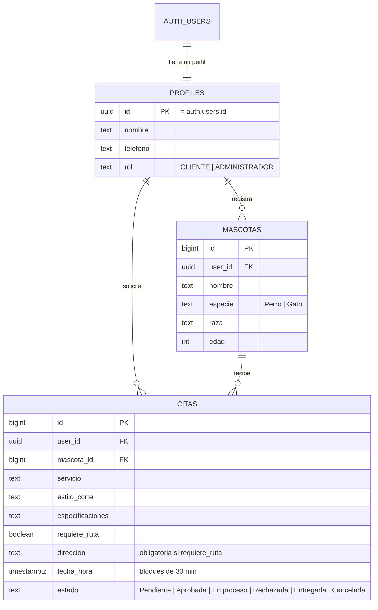

# Modelo de datos · PetStyle (Supabase / PostgreSQL)



## Reglas que garantiza la propia base de datos
| Regla | Cómo se aplica |
|---|---|
| Todo registro nace como CLIENTE | Trigger `handle_new_user` |
| Nadie puede volverse administrador desde la web | `profiles` no tiene política de UPDATE; solo se cambia desde el SQL Editor |
| Cada cliente solo ve y modifica lo suyo | Políticas RLS por tabla |
| El administrador ve todas las citas y el contacto del cliente | Función `es_admin()` + RLS |
| No se puede agendar con la mascota de otro cliente | Política `citas_insert` |
| No se aceptan fechas pasadas | Política `citas_insert` (`fecha_hora > now()`) |
| Sin solapamiento de horarios | Índice único parcial `citas_horario_unico` |
| Si pide ruta, la dirección es obligatoria | Restricción `ruta_requiere_direccion` |
| No se borra una mascota con citas | FK `ON DELETE RESTRICT` |
| El estado avanza en orden y no retrocede | Trigger `validar_transicion_estado` |

## Ciclo de estados
```
Pendiente ──► Aprobada ──► En proceso ──► Entregada
    │             │
    │             └──► Rechazada        (administrador)
    ├──► Rechazada                      (administrador)
    └──► Cancelada                      (cliente, solo si sigue Pendiente)
```
